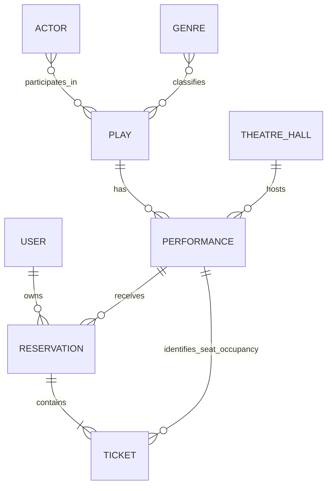

# Theatre API

A REST API for a theatre reservation system, built as a backend portfolio project with Django REST Framework. Visitors can explore plays and performances, check seat availability, and reserve multiple seats online. The project focuses on domain rules, access control, and data integrity under concurrent requests.

## Features

- Public browsing of actors, genres, theatre halls, plays, and performances.
- Catalogue search, filtering, ordering, and pagination.
- User registration and JWT authentication.
- Public seat availability for individual performances.
- Reservation of multiple seats in a single atomic request.
- Private access to each user's reservations and tickets.
- Partial cancellation by deleting a ticket, or complete cancellation by deleting a reservation.
- Time restrictions on booking and cancellation once a performance starts.
- Staff-only catalogue management and protection against destructive deletions.

## Tech Stack

| Technology | Role |
| --- | --- |
| Python 3.13 | Application language |
| Django 5.2 | Framework and ORM |
| Django REST Framework 3.15 | API endpoints and serialization |
| PostgreSQL | Relational database, constraints, and row locking |
| SimpleJWT | Access and refresh tokens |
| django-filter | Catalogue filtering |
| drf-spectacular | OpenAPI schema and Swagger UI |

Dependency versions are defined in `requirements.txt`. For a development environment without installing Python or PostgreSQL locally, see [Docker](#docker).

## Domain Model

| Entity | Responsibility |
| --- | --- |
| `Actor` | An actor associated with plays. |
| `Genre` | A genre used to classify plays. |
| `TheatreHall` | A room with a defined number of rows and seats per row. |
| `Play` | A theatrical work associated with actors and genres. |
| `Performance` | A scheduled presentation of a play in a particular hall. |
| `Reservation` | A user's booking for one performance. |
| `Ticket` | One seat belonging to a reservation. |

A **Play** is the work itself; a **Performance** is a particular presentation of that work at a given time and location. The same play can have several performances, each with its own seat occupancy.

Every reservation belongs to one performance and can contain several tickets. Each ticket also references that performance so the database can enforce seat uniqueness directly.



## Reservation Flow

1. Browse performances and choose a presentation.
2. Request its availability to inspect occupied seats.
3. Authenticate and submit the performance ID together with the desired seats.
4. The backend validates the request and creates the reservation and all tickets within one transaction.

For example, with an existing future performance and valid, unoccupied seats:

```http
POST /api/theatre/reservations/
Authorization: Bearer <access-token>
Content-Type: application/json
```

```json
{
  "performance": 1,
  "seats": [
    {"row": 2, "seat": 5},
    {"row": 2, "seat": 6}
  ]
}
```

**Either all requested seats are reserved, or none are.** An invalid or conflicting seat cannot leave behind a partially created booking.

Availability is a snapshot: another customer may book a seat between the availability request and the reservation request. The booking operation validates the current state again.

## Business Rules

- A reservation belongs to exactly one performance; all its tickets must belong to that performance.
- The server assigns the reservation owner from the authenticated user. Clients cannot choose another owner.
- A seat cannot be booked more than once for the same performance.
- Row and seat numbers must identify positions within the performance's hall.
- New bookings and cancellations are accepted only before the performance starts.
- Deleting an individual ticket cancels that seat. Deleting the last ticket also removes its reservation.
- Deleting a reservation removes all its tickets.
- A performance with reservations cannot be deleted. Deleting a related play or hall is also blocked when it would remove protected performances.

## Concurrency & Data Integrity

Seat occupancy is enforced by a database `UniqueConstraint` on **performance, row, and seat**. API validation provides useful feedback before writing, while the PostgreSQL constraint remains the final guarantee when concurrent requests attempt to book the same seat.

Reservation creation is atomic. Cancellation operations use transactions and `select_for_update()` to lock the affected reservation and prevent inconsistent changes when concurrent requests modify the same booking.

Concurrency scenarios have been tested with separate PostgreSQL connections executing simultaneously. PostgreSQL is the supported database for these guarantees.

## Authentication & Permissions

Users register, obtain an access token and a refresh token, and send the access token with protected requests:

```http
Authorization: Bearer <access-token>
```

| Resource | Public access | Authenticated access |
| --- | --- | --- |
| Catalogue | Read | Only staff can create, update, or delete |
| Performance availability | Read | Read |
| Reservations | None | Create, read, and cancel own reservations |
| Tickets | None | Read and cancel own tickets |

Reservation and ticket queries are scoped to the current user. Accessing another user's object returns **404**, preventing disclosure of its existence through those endpoints.

The user endpoints and their request formats are available in Swagger.

<!-- Before publishing: add the registration, token, and refresh paths verified in user/urls.py and config/urls.py. -->

## API Endpoints

| Endpoint | Purpose |
| --- | --- |
| `/api/theatre/actors/` | Actor catalogue |
| `/api/theatre/genres/` | Genre catalogue |
| `/api/theatre/halls/` | Theatre halls |
| `/api/theatre/plays/` | Plays |
| `/api/theatre/performances/` | Scheduled performances |
| `/api/theatre/performances/{id}/availability/` | Seat occupancy for a performance |
| `/api/theatre/reservations/` | Current user's reservations |
| `/api/theatre/tickets/` | Current user's tickets |

See Swagger for detail routes, supported methods, payloads, and response schemas.

## Filtering, Search & Pagination

Plays support title search, genre filtering, and ordering. Performances support filtering by play, date, and whether they are upcoming or past, with ordering by presentation time.

Collections are paginated with **10 items per page**. Swagger documents the exact query parameter names and accepted values for each endpoint.

<!-- Before publishing: add verified query examples for play title search, performances by play, and upcoming performances. -->

## OpenAPI / Swagger

The API specification is generated with **drf-spectacular**:

| URL | Documentation |
| --- | --- |
| `/api/docs/` | Interactive Swagger UI |
| `/api/schema/` | OpenAPI schema |

The schema documents JWT authentication, filters, pagination, distinct read/write contracts, and **409 Conflict** responses. In particular, reservation creation accepts performance and seat data, while the successful response describes the created reservation and its tickets.

The schema has been validated using the generator's validation command. To generate and validate it locally:

```bash
python manage.py spectacular --validate --file schema.yml
```

## Running Locally

Requirements: Python 3.13, Git, and a running PostgreSQL instance.

### 1. Clone the repository

Replace `<repository-url>` with this repository's clone URL:

```bash
git clone <repository-url> API-Theatre
cd API-Theatre
```

### 2. Create and activate a virtual environment

```bash
python -m venv .venv
```

Windows PowerShell:

```powershell
.\.venv\Scripts\Activate.ps1
```

Linux / macOS:

```bash
source .venv/bin/activate
```

### 3. Install dependencies

```bash
python -m pip install -r requirements.txt
```

### 4. Configure PostgreSQL and application settings

Create a PostgreSQL database and a local database user. Copy `.env.example` to `.env`, set a new `SECRET_KEY`, and configure your local database credentials. For host execution, change `DB_HOST` to `localhost` and set `DB_PORT` to your local PostgreSQL port.

`python-dotenv` loads `.env`; existing process environment variables take precedence. Keep local credentials out of version control. The host database and the Docker database are independent.

### 5. Apply migrations

```bash
python manage.py migrate
```

Optionally create a superuser for catalogue administration:

```bash
python manage.py createsuperuser
```

### 6. Start the development server

```bash
python manage.py runserver
```

Open [Swagger UI](http://127.0.0.1:8000/api/docs/) to explore the API. Use a staff account to populate the catalogue before creating reservations.

## Environment Variables

Use [`.env.example`](.env.example) as the configuration template. `.env` and local `.env.*` files are ignored by Git and excluded from the Docker image.

| Variable | Purpose / default |
| --- | --- |
| `SECRET_KEY` | Required Django signing key; supply a new value for your environment. |
| `DEBUG` | Defaults to false; `1`, `true`, and `yes` enable it, case-insensitively. |
| `ALLOWED_HOSTS` | Comma-separated hosts; defaults to `localhost,127.0.0.1`. |
| `DB_NAME` | PostgreSQL database name. |
| `DB_USER` | PostgreSQL user. |
| `DB_PASSWORD` | PostgreSQL password. |
| `DB_HOST` | Defaults to `localhost` outside Docker; Compose sets `db`. |
| `DB_PORT` | Defaults to `5432`; Compose sets `5432`. |

Compose maps the same `DB_NAME`, `DB_USER`, and `DB_PASSWORD` values to PostgreSQL's initialization variables. These initialize a new volume; changing them later does not update credentials in an existing database.

## Database

**PostgreSQL** is the supported database. Its unique constraints, transactions, and row locking underpin the reservation and cancellation guarantees.

## Tests

Run the suite against PostgreSQL:

```bash
python manage.py test
```

The database user must have permission to create Django's test database.

The suite covers authentication, ownership, staff permissions, reservation validation, availability, concurrent operations, atomicity, cancellation, catalogue filters, pagination, OpenAPI contracts, and protected deletions.

**Latest recorded Docker run: 98 tests passing, no skips, on Linux and PostgreSQL 18.6.** This includes the PostgreSQL concurrency tests. This is a test result, not a measured code coverage percentage.

## Technical Decisions

- **A reservation directly references its performance.** This expresses the single-performance booking rule and makes ownership and cancellation operations easier to reason about.
- **Tickets also reference the performance.** This allows PostgreSQL to enforce seat uniqueness on the ticket table itself. Booking validation maintains consistency with the reservation's performance.
- **Availability returns `occupied_seats`.** Clients can derive free seats from the hall dimensions without receiving an exhaustive list of every available position.
- **Read and write contracts serve different needs.** Read responses include summarized related objects; write requests use IDs to select existing resources.
- **Multi-seat creation is atomic.** A failed request cannot leave a reservation with only some of the requested seats.
- **Cancellation locks the reservation.** Changes to the same booking are coordinated, including removal of its last remaining ticket.

## Project Structure

| Path | Responsibility |
| --- | --- |
| `config/` | Project settings and root URL configuration |
| `theatre/` | Theatre models, endpoints, serializers, filters, permissions, and business rules |
| `user/` | User model, registration, and authentication |
| `manage.py` | Django management commands |
| `requirements.txt` | Project dependencies |

Tests and database migrations live in their respective apps.

## Scope

The project demonstrates a backend API for catalogue management and seat reservations. Its infrastructure goal ends at containerized execution with Django and PostgreSQL.

A dedicated frontend, ticket pricing, payments, payment gateway integrations, and deployment are outside the project's scope.

## Docker

Prerequisites: Docker and Docker Compose, with the Docker engine running in Linux container mode. Local Python and PostgreSQL installations are not required.

After cloning the repository and entering its directory, create the local configuration:

```bash
cp .env.example .env
```

In Windows PowerShell, use `Copy-Item .env.example .env`. Keep an existing `.env` if you already have one and review its values instead of overwriting it. Replace the placeholder `SECRET_KEY` and `DB_PASSWORD` with new development-only values; keep `DEBUG=True`. Do not commit `.env`.

Build and start the two services:

```bash
docker compose up -d --build
docker compose ps
```

PostgreSQL must pass its `pg_isready` healthcheck before Django starts. The web service automatically applies existing migrations, then starts `runserver` on `0.0.0.0:8000`. If migrations fail, the server does not start. No migrations or superusers are generated automatically.

| Service | URL |
| --- | --- |
| Theatre API root | http://localhost:8000/api/theatre/ |
| Swagger UI | http://localhost:8000/api/docs/ |
| OpenAPI schema | http://localhost:8000/api/schema/ |
| Admin | http://localhost:8000/admin/ |

The initial database is empty. Create a superuser interactively, then use Admin to populate the catalogue:

```bash
docker compose exec web python manage.py createsuperuser
```

Operational commands:

```bash
docker compose logs web db
docker compose exec web python manage.py check
docker compose exec web python manage.py migrate
docker compose exec web python manage.py test
```

The manual `migrate` command is available when needed; it is not required after every startup. Tests run inside the Linux Django container against PostgreSQL, including concurrency tests.

Code is copied into the image, without a bind mount. After changing code or dependencies, run `docker compose up -d --build` again. This setup deliberately uses Django's development server and is not a production deployment.

Stop the environment:

```bash
docker compose down
```

This removes containers and the network but preserves database data in the named `postgres_data` volume. PostgreSQL is available internally at `db:5432`; its port is not published to the host. The volume is independent of any local PostgreSQL installation.

To deliberately reset the Docker database:

```bash
docker compose down -v
```

**This also removes the PostgreSQL volume and its data.** The next `docker compose up -d --build` creates an empty database and reapplies the existing migrations.
